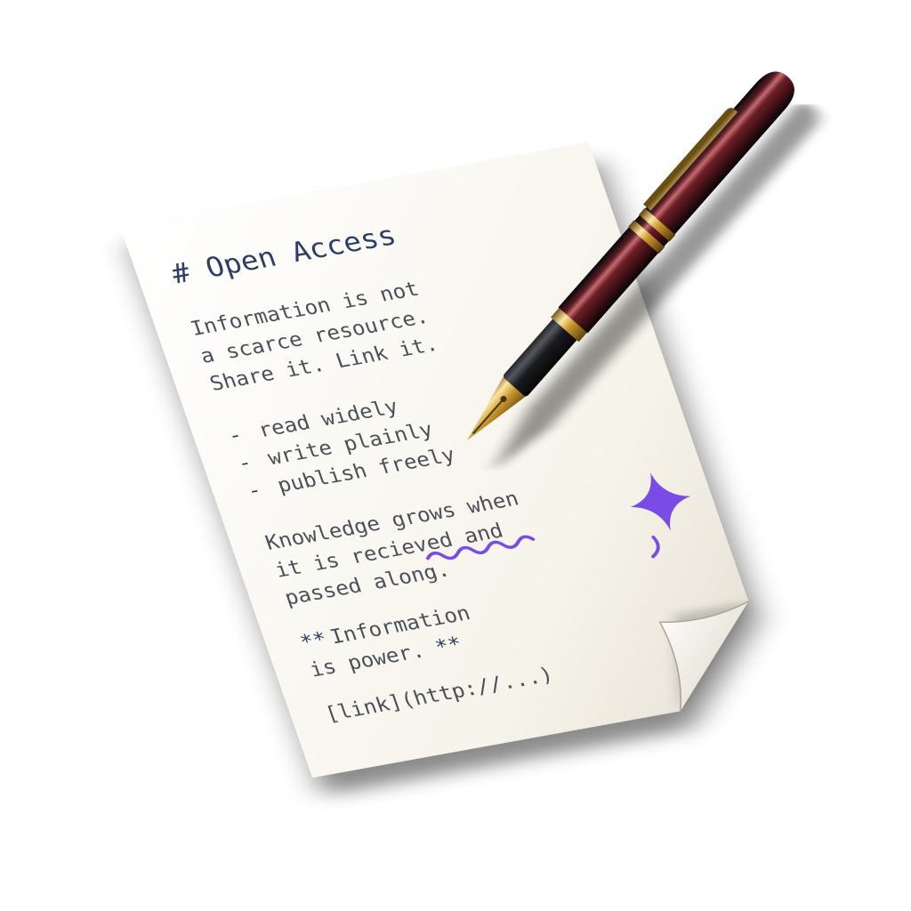

<p align="center">
  
</p>

# Aaron

Aaron is a native macOS Markdown editor for writing blog posts. It offers:

- **Live preview** in a side panel, rendered by a built-in Markdown renderer
  or by your own tools (for example your blog's real Pelican theme).
- **AI review**: configurable actions (grammar, fact checking, style, …) that
  produce suggestions you accept or dismiss one by one. They run on your
  existing Claude Code or Codex subscription through their command-line tools.
- **Pelican support**: metadata awareness, tag autocompletion and a new-post
  template.
- **Profiles**: complete sets of settings, such as one for plain notes and one
  for your blog, switchable per window.
- **The `aaron` command** to open files from Terminal or your own scripts, with
  a chosen profile.

Nothing is tied to a particular blog or folder layout; every tool and path is
configurable..

## Getting started

You need macOS 26 or later, Xcode 26 or later, and
[XcodeGen](https://github.com/yonaskolb/XcodeGen) (`brew install xcodegen`).

1. Build and install the app into `/Applications`:
   ```sh
   scripts/install.sh
   ```
2. Open Aaron. The app is signed locally, so the first time you may need to
   Control-click it in Finder and choose **Open**.
3. Optionally, choose **Aaron ▸ Install Command Line Tool…** to get the
   `aaron` command, then open files with `aaron [--profile NAME] FILE…`.
4. For AI review, have [Claude Code](https://claude.com/claude-code) (`claude`)
   or [Codex](https://developers.openai.com/codex) (`codex`) installed and
   logged in. Aaron never asks for an API key.

## Documentation

- [User guide](docs/user/README.md): everything you can do with Aaron, starting
  with [Getting started](docs/user/getting-started.md).
- [Developer documentation](docs/README.md): building, design, testing and the
  decisions behind the first version.

## License

Aaron is released under the [MIT License](LICENSE).
