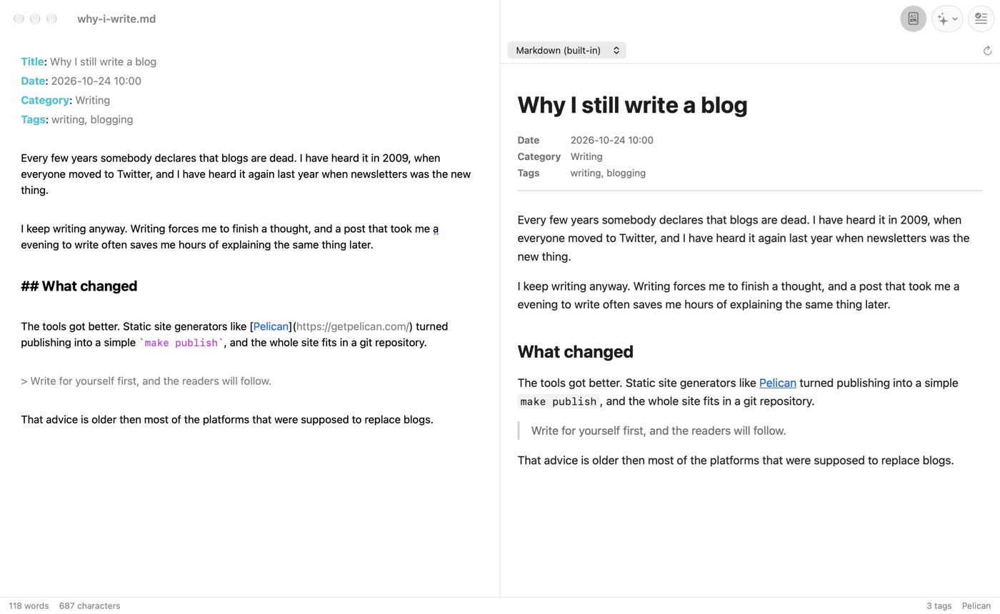

# Pelican support

Aaron knows a few things about [Pelican](https://getpelican.com/) posts. It
needs no Pelican installation for this, and nothing is tied to a particular
blog: tools are plugged in through Settings.



## Pelican mode

A document is treated as a Pelican post when it starts with a metadata block
that contains a `Title:` field:

```markdown
Title: Why I still write a blog
Date: 2026-10-24 10:00
Category: Writing
Tags: writing, blogging

The post starts here.
```

The block is a run of `Key: value` lines at the very top, ended by an empty
line (or the end of the document). Lines indented by four spaces or a tab
continue the previous value. If the lines are followed directly by ordinary
text, they are not metadata. A document starting with "Note: …" followed
by more text is plain Markdown.
The status bar shows **Pelican** for such documents, **Markdown** otherwise,
and the mode updates as you type.

**Settings ▸ Pelican ▸ Pelican mode** changes the detection:

- **Automatic** (default): as described above.
- **Always on**: every document is a Pelican post, also ones with YAML front
  matter (`---` … `---`). Tag completion then works on a YAML `tags:` line too.
- **Off**: no document is a Pelican post.

In Pelican mode:

- tags are loaded and completed on the `Tags:` line (below),
- the preview uses the default renderer for Pelican posts
  ([Preview](preview.md#choosing-a-renderer)),
- the status bar shows how many tags are known.

Metadata highlighting, the metadata header in the built-in preview and word
counts that skip the metadata work for every document with a metadata
block, not only in Pelican mode.

## Tag completion

On the `Tags:` line Aaron offers the tags you have used before.

- **While typing** a tag, the list opens by itself, with the best match
  selected. Use ↑ and ↓ to choose, Return to insert the tag, or Esc to close
  the list and keep what you typed.
- **Esc** (or ⌥Esc) opens the list on demand. With nothing typed yet, for
  example right after a comma, it lists all tags, most used first.

Which tags are offered:

1. tags that **start with** what you typed,
2. then tags in which a **later word** starts with it (`rev` → *annual review*),
3. then tags that **contain** it anywhere (`ook` → *notebook*).

Within each group, tags used more often come first. Matching ignores case
and accents (`ecr` finds *écriture*). Tags already on the line are not
offered again. Tags can contain spaces. The completion replaces only the tag
you are typing, between the commas.

### Where tags come from

Aaron runs a **tag command** you configure in **Settings ▸ Pelican ▸ Tag
command**, for example a script that collects the tags from all your posts.
The command runs when a Pelican post is opened, or when a document becomes
one, in the **Working directory** you set (default: the post's folder).
Placeholders such as `{dir}` and `{file}` refer to the open post, as for
[preview commands](preview.md#placeholders). The command must finish within
the timeout (default 15 seconds).

Its output may be:

- JSON with a `tags` list of objects with `name` and optionally `count`
  (the format of `scripts/list-tags --json`):
  ```json
  {"tags": [{"name": "review", "count": 25}, {"name": "books", "count": 16}]}
  ```
- a JSON list of names, or of such objects: `["review", "books"]`,
- plain text with one tag per line, optionally preceded by how often it is
  used: `25 review`.

Duplicate names that differ only in case are merged.

The result is cached and shared by all windows that use the same command
and folder. Run **Edit ▸ Refresh Pelican Tags** after adding new tags
elsewhere. **Test Command** in Settings runs the command and shows how many
tags it found. Placeholders that refer to a document are empty there.

If the command fails, the status bar shows **Tags unavailable**. Hover over
it to see the error. Completion then offers nothing, and the next Pelican
document you open tries again.

## Help for Pelican syntax and plugins

**Help ▸ Markdown Help** (⇧⌘M) on a Pelican post includes Pelican's metadata
fields, its link syntax and help for the plugins your site uses. See
[Markdown Help](markdown-help.md) for setting up the plugins command.

## New posts

**File ▸ New Pelican Post** (⌥⌘N) opens a new document from the template in
**Settings ▸ Pelican ▸ New post template** of the default
[profile](profiles.md), which the new window also uses. In the template, `{date}` becomes
the current date and time (`2026-10-24 10:00`) and `{day}` the date
(`2026-10-24`). The default template is:

```
Title: 
Date: {date}
Category: 
Tags: 
Slug: 
Status: draft
```
