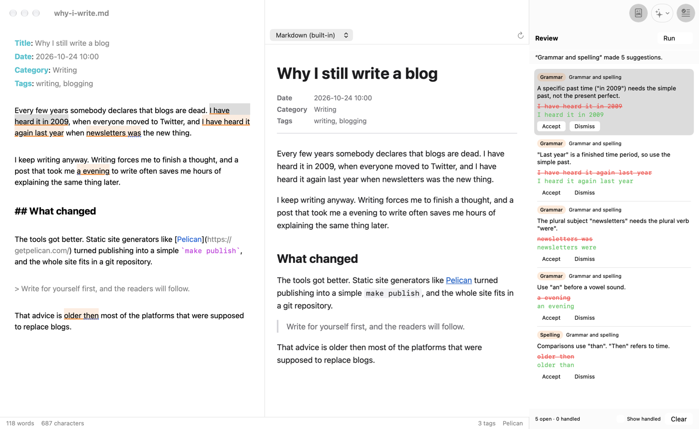

# AI review

Review mode asks an AI to look at your document for a specific purpose, such
as grammar, fact checking or style, and shows what it found as
**suggestions**. Nothing in your text changes until you accept a suggestion.

## Opening review mode

- Click the **Review** toolbar button or choose **View ▸ Show/Hide Review**
  (⌥⌘R). This opens the review panel on the right of the window.
- Running any AI action also opens it.

Closing the panel does not discard the suggestions; open it again to continue.

## Running an AI action

Choose an action from any of these places:

- the **AI Actions** toolbar menu (sparkles icon),
- the **Run** menu at the top of the review panel,
- the **Review** menu in the menu bar; the first nine actions have the
  shortcuts ⌥⌘1 to ⌥⌘9.

The actions available, and what each asks the AI to do, are set up in
**Settings ▸ AI** (see [Setting up AI actions](ai-setup.md)). The default
actions are **Grammar and spelling**, **Fact check** and **Style**.

While the action runs:

- The panel shows **Running "…"** with a spinner.
- **The document is read-only.** This guarantees the suggestions match the
  text that was sent. Depending on the document's length and the AI, a run
  takes from a few seconds to a minute or two (fact checking with web search
  takes longest).
- **Cancel** (or ⌘.) stops the action; nothing is added.

Only one action can run at a time in a window. Other windows are not
affected.

### Reviewing only part of the document

If text is selected when you run an action, the AI is asked to comment only
on the selected passage. The whole document is still sent along, so the AI
has the context.

### What is sent

The AI receives the action's prompt, instructions about the answer format,
your selection (if any) and the full current text of the document, including
unsaved changes and the metadata block. It does not receive the file's path
or any other files.

## Suggestions

When the AI answers, a line at the top of the panel summarises the result,
for example *"Grammar and spelling" made 5 suggestions*, and how many of them
could not be located in the text, if any. If the AI found nothing, it says
*"…" found nothing to suggest*.

Each suggestion appears in two places:

- **In the editor**, the text it refers to is underlined and tinted:
  **orange** for suggested changes, **blue** for comments without a concrete
  change. The selected suggestion is tinted more strongly.
- **In the panel**, as a card with the text in 14-point type and:
  - a label with the suggestion's category (for example *Grammar*,
    *Spelling*, *Style*, *Fact*), as given by the AI, and the name of the action
    that produced it,
  - the AI's explanation,
  - the original text (red, struck through) and the replacement (green), or
    just the quoted text for comments,
  - **Accept** and **Dismiss** buttons.

Suggestions are listed in the order they appear in the document. Ones that
could not be placed in the text come last.

The selected card has a light pastel background: orange for changes, blue
for comments (darker shades in dark mode).

Clicking a card selects the suggestion, then scrolls the editor to it,
selects its text and flashes it. Clicking into highlighted text in the editor
selects the matching card. If several suggestions overlap there, the one
covering the shortest passage is chosen.

Running more actions adds their suggestions to the list, so you can, for
example, run *Grammar and spelling* and then *Style* and work through both.

### Accepting and dismissing

- **Accept** replaces the original text with the suggestion and selects the
  next suggestion. The replacement is an ordinary edit: you can undo it.
- **Dismiss** removes the suggestion's highlight without changing the text.
- Menu and keyboard: **Review ▸ Accept Suggestion** (⌥⌘↩),
  **Review ▸ Dismiss Suggestion** (⌥⌘⌫), **Review ▸ Next Suggestion** (⌥⌘])
  and **Review ▸ Previous Suggestion** (⌥⌘[). Next and previous go through the
  highlighted suggestions in document order and wrap around.

Comments (suggestions without a replacement) can only be dismissed.

### Editing while suggestions are open

You can keep writing while suggestions are open. Aaron keeps track of where
each suggestion's text moves:

- Edits before or after a suggestion move its highlight along with the text.
- If you change the text a suggestion refers to, either by typing or by
  accepting an overlapping suggestion, it is marked **Text changed**. It can
  no longer be accepted, because the replacement might no longer fit, but it
  can be dismissed.
- When you accept a suggestion, Aaron first checks that the text still
  matches what the AI quoted. If it does not, the suggestion is marked
  **Text changed** instead of being applied.

### Suggestions that could not be placed

The AI identifies text by quoting it, never by position. Aaron searches the
document for the exact quote, using the text the AI quoted just before and
after it to tell repeated phrases apart. If the quote does not occur in the
text, the suggestion is marked **Not found in text**. If it occurs several
times and the surrounding text doesn't decide which, it is marked
**Ambiguous**. Either way it has no highlight and can only be dismissed. When
the surrounding text the AI quoted does not match but the quote itself occurs
exactly once, that occurrence is used.

### Changing your mind

Accepted and dismissed suggestions disappear from the list. Tick **Show
handled** at the bottom of the panel to see them again, slightly dimmed and
labelled **Accepted** or **Dismissed**, with a button to reverse the
decision:

- **Revert** (accepted suggestions) puts the original text back and makes
  the suggestion open again. Like accepting, this is an ordinary edit you
  can undo with ⌘Z.
- **Reopen** (dismissed suggestions) makes the suggestion open again, with
  its highlight.

Aaron keeps track of where handled suggestions are while you go on editing.
If you change the text a handled suggestion refers to (the replacement of an
accepted one, or the quoted text of a dismissed one), it can no longer be
reverted or reopened, and the button is disabled; hover over it to see why.

The footer counts open and handled suggestions.

### Undo

Undoing an accepted suggestion with ⌘Z restores the original text. The
suggestion stays marked as accepted, but its **Revert** button becomes
disabled, because the replacement is no longer in the text. Use **Revert**
instead of ⌘Z if you want the suggestion back in the list.

### Clearing

**Clear** (or **Review ▸ Clear Suggestions**) removes all suggestions.
Suggestions are also discarded when you close the window; they are not
saved with the document.

## When something goes wrong

If the AI tool fails, the panel shows an orange note with the error. It
includes the tool's own message, such as "not logged in", or the start of its
answer if the answer was not in the expected format. Close the note with ×.
Common causes and fixes are in [Troubleshooting](troubleshooting.md#ai-actions).

If the document changed while an action was running (which normally cannot
happen, because the editor is read-only), the results are discarded and the
note says so.
